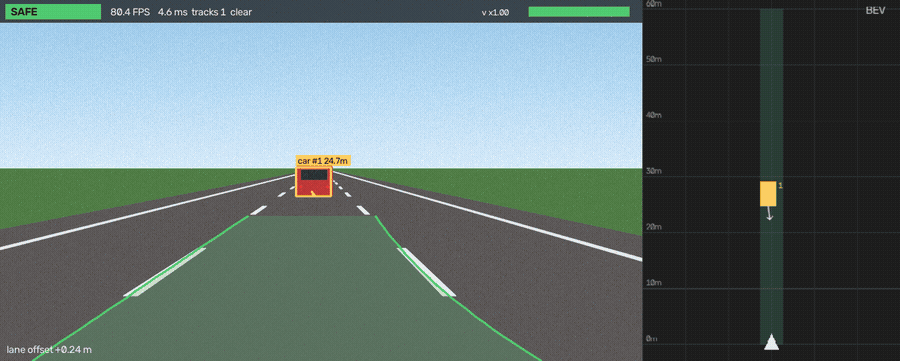
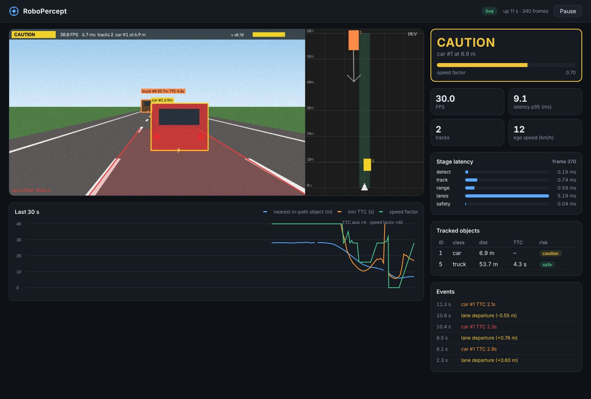

<div align="center">

# RoboPercept

### Détection d'objets en temps réel, suivi, télémétrie monoculaire et risque de collision pour robots et véhicules autonomes

Une caméra en entrée, **une consigne de vitesse en sortie**. RoboPercept détecte et suit les usagers de la route et les obstacles, mesure leur distance avec une seule caméra, prédit le temps avant collision et indique au robot ou au véhicule à quelle vitesse il peut rouler, en direct, sur un simple processeur.


[English](README.md) · [Architecture](docs/architecture.md) · [Sécurité](docs/safety.md) · [ROS 2](docs/ros2.md) · [Déploiement](docs/deployment.md) · [État de l'art](docs/state_of_the_art.md)



</div>

---

## Pourquoi RoboPercept

Un détecteur seul ne rend pas un robot sûr. Les boîtes doivent devenir **des objets dotés d'une identité**, ces objets doivent recevoir **une distance et une vitesse**, et le tout doit se traduire en **une décision** exécutable par un contrôleur de mouvement. La plupart des projets open source s'arrêtent aux boîtes. RoboPercept implémente toute la chaîne dans un seul paquet Python lisible :

```
caméra ─▶ détecteur ─▶ suivi multi-objets ─▶ télémétrie monoculaire ─▶ mouvement au sol ─▶ TTC et risque ─▶ facteur de vitesse
                                  └─▶ voies, zones, événements ─▶ tableau de bord / ROS 2 / MQTT / journaux
```

Le projet fournit aussi un **simulateur en boucle fermée** : des scènes urbaines et d'entrepôt générées de façon procédurale, rendues avec le même modèle de caméra et accompagnées d'une vérité terrain exacte. Le facteur de vitesse calculé par la couche de sécurité pilote le véhicule simulé : on voit le système freiner derrière une voiture ou devant un piéton qui traverse, sur n'importe quel ordinateur portable, sans GPU, sans jeu de données et sans poids à télécharger. Chaque commit est évalué contre la vérité terrain dans l'intégration continue.

## Fonctionnalités

| Domaine | Contenu |
|---------|---------|
| **Détection** | Modules interchangeables : Ultralytics **YOLO26** (sans NMS, de bout en bout), YOLO11, **RT-DETR**, **RF-DETR**, **YOLOE-26** à vocabulaire ouvert par invites textuelles, tout export **ONNX** via ONNX Runtime (TensorRT, CUDA ou CPU), plus un module de simulation |
| **Suivi** | **ByteTrack** en NumPy : association en deux passes qui récupère les objets partiellement masqués grâce aux détections peu confiantes, filtre de Kalman, vote de classe pondéré, **compensation du mouvement de la caméra** pour les plateformes mobiles |
| **Télémétrie** | Distance avec une seule caméra à partir du **point de contact au sol** et de la **taille de l'objet**, fusionnés par pondération inverse de la variance, position latérale non biaisée ; profondeur dense optionnelle avec **Depth Anything V2/V3** et recalage métrique en ligne |
| **Mouvement** | Filtre de Kalman à vitesse constante par objet sur le plan du sol : position lissée et vitesse relative en mètres |
| **Sécurité** | Temps avant collision avec le couloir du véhicule (piétons qui traversent inclus), distance d'arrêt, profils **véhicule** (alerte de collision avant) et **robot** (surveillance vitesse et séparation), anti-rebond, **gouverneur de vitesse** à taux limité |
| **Scène** | Détection de la voie avec alerte de franchissement, **zones** polygonales en coordonnées image ou sol (zones interdites, champs de protection) avec événements d'entrée, de présence prolongée et de sortie |
| **Sorties** | Vidéo annotée avec **vue de dessus**, télémétrie JSON lignes, captures d'événements, MQTT, métriques Prometheus |
| **Tableau de bord** | Interface web sans dépendance : vidéo MJPEG, décision, latence par étape, objets suivis, journal d'événements, historique sur 30 s |
| **Robotique** | Paquet ROS 2 publiant `vision_msgs/Detection2DArray`, des marqueurs RViz et un facteur de vitesse, plus un nœud gouverneur `cmd_vel` à sécurité intrinsèque ; passerelle CARLA |
| **Ingénierie** | Configuration YAML typée (pydantic), ligne de commande, 57 tests, évaluation CLEAR-MOT / IDF1 / erreur de distance, banc de latence, Docker (CPU et Jetson), CI GitHub Actions |

## Démarrage rapide

```bash
git clone https://github.com/FarhatMohamd/robopercept.git
cd robopercept
pip install -e .

robopercept demo                         # scénario urbain, ouvrir http://localhost:8080
robopercept demo --scenario warehouse    # robot mobile parmi des opérateurs et un chariot élévateur
```

Avec une vraie caméra ou une vidéo :

```bash
pip install -e ".[yolo]"
robopercept run -c configs/vehicle_yolo26.yaml -s dashcam.mp4 --serve
robopercept run -c configs/robot_onnx.yaml --set detector.conf=0.4 --save runs/robot.mp4
```

Évaluation et mesure de performance :

```bash
robopercept eval --scenario urban --frames 960
robopercept bench -c urban --frames 600
```

## Principe

**Télémétrie monoculaire.** Connaissant les paramètres intrinsèques de la caméra, sa hauteur `H` au-dessus d'un sol plat et son inclinaison, le bord inférieur d'une boîte donne la profondeur du point de contact : `z = f·H / (v − v_horizon)`. Cet indice est exact sur sol plat mais son erreur croît comme `z²` ; il est donc fusionné avec l'a priori de taille `z = f·h_classe / h_pixels`, dont l'erreur croît linéairement. Les poids sont les inverses des variances et l'incertitude est augmentée quand les indices divergent. La position latérale utilise le bord de la boîte le plus proche de l'axe optique, qui correspond au coin intérieur éloigné de l'objet, corrigé par l'empreinte de la classe : le biais du centre de boîte disparaît pour les objets décentrés.

**Temps avant collision.** Chaque objet suivi possède un filtre de Kalman au sol. Le TTC est l'instant où l'objet atteint l'avant du véhicule *en étant dans son couloir* : un piéton qui se dirige vers la chaussée déclenche une alerte avant de passer devant le véhicule, une voiture qui arrive en sens inverse sur l'autre voie n'en déclenche pas.

**Décision.** L'objet le plus critique fixe le niveau (`safe`, `caution`, `warning`, `critical`) et un facteur de vitesse dans `[0, 1]`. Les niveaux sont filtrés dans le temps ; le facteur chute instantanément et remonte à vitesse bornée. Les règles exactes et les limites d'un système consultatif sont décrites dans [docs/safety.md](docs/safety.md).

## Résultats mesurés

Scores de la chaîne complète contre la vérité terrain du simulateur (`robopercept eval`, un cycle complet de chaque scénario). Le module de simulation reproduit les erreurs d'un détecteur (4 % d'oublis de base, davantage pour les petits objets ou les objets masqués, bruit sur les boîtes, fausses détections peu confiantes).

| Métrique | Urbain (véhicule) | Entrepôt (robot) |
|----------|------------------:|-----------------:|
| MOTA | 0,879 | 0,877 |
| IDF1 | 0,906 | 0,936 |
| Changements d'identité | 6 sur 3 103 objets | 1 sur 1 085 objets |
| Erreur relative moyenne de distance | 3,9 % | 4,7 % |
| Erreur relative médiane de distance | 2,2 % | 3,1 % |
| Erreur absolue moyenne latérale | 0,04 m | 0,22 m |
| Latence p95 de la chaîne (CPU, 2 cœurs) | 7,9 ms | 6,2 ms |

Ces latences excluent le réseau de neurones, dont le coût dépend du modèle et du matériel (par exemple environ 1,7 ms pour YOLO26-N sur GPU T4 avec TensorRT FP16 d'après l'article YOLO26). Le simulateur valide la géométrie, le suivi et les règles de sécurité ; sur des images réelles, la précision de distance dépend d'abord de l'étalonnage de la caméra et de l'hypothèse de sol plat.

## Tableau de bord web

`--serve` lance un tableau de bord sur le port 8080, écrit uniquement avec la bibliothèque standard de Python.

<div align="center">

</div>

## Intégration ROS 2

Le paquet `ros2_ws/src/robopercept_ros` (ROS 2 Jazzy) publie `/robopercept/detections` (`vision_msgs/Detection2DArray`), `/robopercept/markers` (RViz), `/robopercept/speed_factor` et `/robopercept/safety`. Le nœud `speed_governor` s'insère entre le planificateur et la base (`/cmd_vel_nav` → `/cmd_vel`), réduit la vitesse d'avance selon le facteur et **arrête le robot si la perception se tait** plus de 0,5 s. Détails dans [docs/ros2.md](docs/ros2.md).

## Déploiement

| Cible | Méthode |
|-------|---------|
| PC portable ou fixe | `pip install -e ".[yolo]"` |
| NVIDIA Jetson Orin | `docker/Dockerfile.jetson`, moteur TensorRT exporté sur la carte : `python scripts/export_model.py --model yolo26s.pt --format engine --half` |
| Robot sur CPU (Raspberry Pi 5, NUC) | export ONNX ou OpenVINO, `configs/robot_onnx.yaml` |
| Docker | `docker compose up demo` |
| CARLA | `python scripts/carla_bridge.py --config configs/vehicle_yolo26.yaml` |

Étalonnage : `scripts/calibrate_camera.py`. Apprentissage sur données routières : `scripts/convert_kitti.py` puis `scripts/train.py --data datasets/bdd100k.yaml`. Voir [docs/deployment.md](docs/deployment.md).

## Citation et licence

```bibtex
@software{farhat_robopercept_2026,
  author  = {Farhat, Mohamad},
  title   = {RoboPercept: real-time perception and collision risk for autonomous robots and vehicles},
  year    = {2026},
  version = {1.0.0},
  url     = {https://github.com/FarhatMohamd/robopercept}
}
```

Code sous [licence MIT](LICENSE). Les modèles pré-entraînés gardent leur propre licence (AGPL-3.0 ou Enterprise pour Ultralytics, Apache-2.0 pour RF-DETR de Nano à Large et pour le code original de RT-DETR).

**Avertissement de sécurité.** RoboPercept est un outil de recherche et d'enseignement. Ses sorties sont consultatives et ne constituent pas une fonction de sécurité certifiée : ne l'utilisez jamais comme unique protection d'une machine pouvant blesser quelqu'un.

---

<div align="center">Auteur : <b>FARHAT Mohamad</b> · Arts et Métiers Institute of Technology</div>
