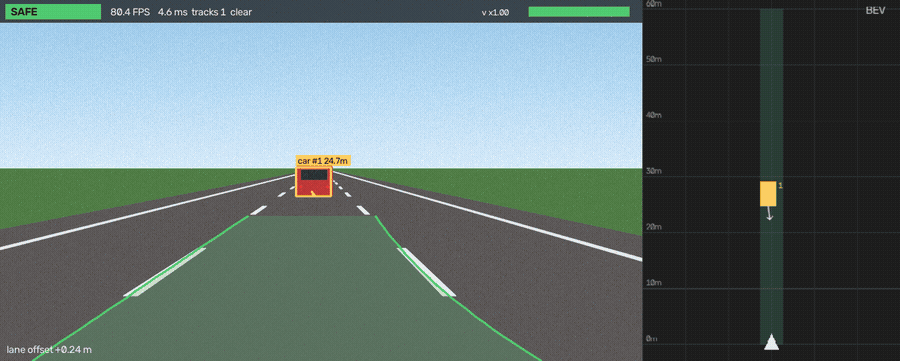
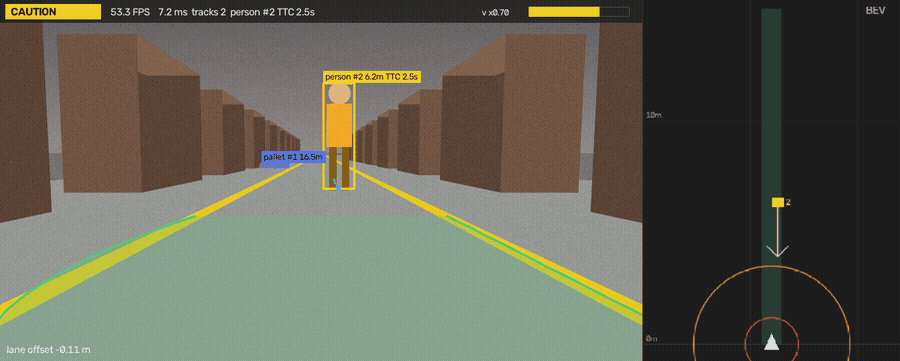
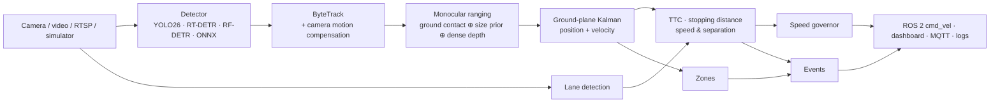
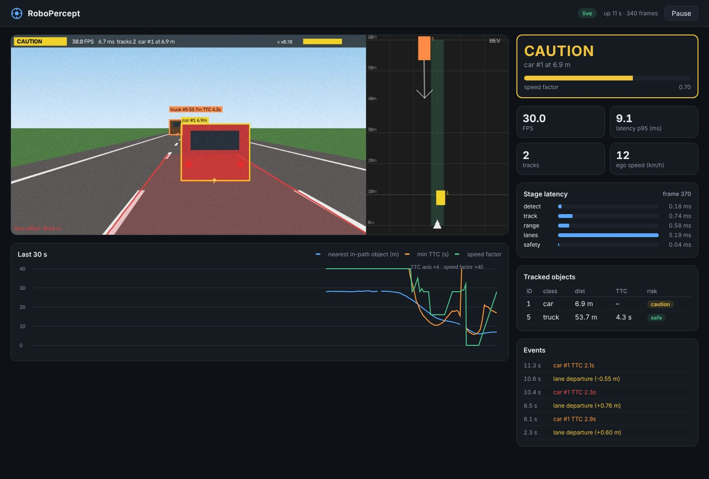

<div align="center">

# RoboPercept

### Real-time object detection, tracking, monocular ranging and collision risk for autonomous robots and vehicles

Camera in, **speed command out**. RoboPercept detects and tracks road users and obstacles, measures how far they are with a single camera, predicts time-to-collision and tells the robot or vehicle how fast it may go, live, on a CPU.


[Français](README.fr.md) · [Architecture](docs/architecture.md) · [Safety](docs/safety.md) · [ROS 2](docs/ros2.md) · [Deployment](docs/deployment.md) · [State of the art](docs/state_of_the_art.md)



</div>

---

## Table of contents

1. [Why RoboPercept](#why-robopercept)
2. [Features](#features)
3. [Quick start](#quick-start)
4. [How it works](#how-it-works)
5. [Detector backends](#detector-backends)
6. [Configuration](#configuration)
7. [Measured results](#measured-results)
8. [Web dashboard](#web-dashboard)
9. [ROS 2 integration](#ros-2-integration)
10. [Deployment](#deployment)
11. [Project layout](#project-layout)
12. [Roadmap](#roadmap)
13. [Citation and license](#citation-and-license)

## Why RoboPercept

A detector alone does not keep a robot safe. Boxes must become **objects with an identity**, objects must get **a distance and a velocity**, and those must turn into **a decision** a motion controller can execute. Most open-source projects stop at the boxes. RoboPercept implements the whole chain in one readable Python package:

```
camera ─▶ detector ─▶ multi-object tracker ─▶ monocular ranging ─▶ ground-plane motion ─▶ TTC & risk ─▶ speed factor
                                     └─▶ lanes, zones, events ─▶ dashboard / ROS 2 / MQTT / logs
```

It also ships a **closed-loop simulator**: procedural urban and warehouse scenes rendered through the same camera model, with exact ground truth. The speed factor computed by the safety layer drives the simulated ego vehicle, so you can see the system brake for a lead car or a crossing pedestrian on any laptop, without a GPU, a dataset or downloaded weights, and every commit is scored against ground truth in CI.

## Features

| Area | What you get |
|------|--------------|
| **Detection** | Pluggable backends: Ultralytics **YOLO26** (NMS-free, end-to-end), YOLO11, **RT-DETR**, **RF-DETR**, **YOLOE-26 open-vocabulary** text prompts, any **ONNX** export through ONNX Runtime (TensorRT / CUDA / CPU providers), plus a ground-truth simulator backend |
| **Tracking** | **ByteTrack** written in NumPy: two-stage association that recovers occluded objects from low-confidence boxes, Kalman filter, score-weighted class voting, optional **camera motion compensation** for moving platforms |
| **Ranging** | Single-camera distance from the **ground-contact** cue and the **object-size** prior, fused by inverse-variance weighting, with an unbiased lateral estimate from the box inner edge; optional dense depth from **Depth Anything V2/V3** with online metric scale fitting |
| **Motion** | Per-object constant-velocity Kalman filter on the ground plane: smoothed position and relative velocity in metres |
| **Safety** | Time-to-collision with the ego corridor (crossing pedestrians included), stopping-distance check, **vehicle** (forward-collision warning) and **robot** (speed & separation monitoring) profiles, debouncing, rate-limited **speed governor** |
| **Scene** | Classical ego-lane detection with lane-departure warning, polygonal **zones** in image or ground coordinates (keep-out areas, protective fields) with enter / dwell / exit events |
| **Outputs** | Annotated video with a **bird's-eye view**, JSON-lines telemetry, event snapshots, MQTT, Prometheus `/metrics` |
| **Dashboard** | Zero-dependency web UI: live MJPEG video, decision card, latency per stage, tracks table, event log, 30 s history chart |
| **Robotics** | ROS 2 package publishing `vision_msgs/Detection2DArray`, RViz markers and a speed factor, plus a fail-safe `cmd_vel` governor node; CARLA bridge script |
| **Engineering** | Typed YAML configuration (pydantic), CLI, 57 tests, CLEAR-MOT / IDF1 / range-error evaluation, per-stage latency benchmark, Docker (CPU and Jetson), GitHub Actions CI |

## Quick start

```bash
git clone https://github.com/FarhatMohamd/robopercept.git
cd robopercept
pip install -e .                 # core: NumPy, OpenCV, SciPy, pydantic, PyYAML

robopercept demo                 # urban closed-loop scenario, open http://localhost:8080
robopercept demo --scenario warehouse   # mobile robot among operators and a forklift
```

With a real camera or video:

```bash
pip install -e ".[yolo]"                                   # Ultralytics + PyTorch
robopercept run -c configs/vehicle_yolo26.yaml -s dashcam.mp4 --serve
robopercept run -c configs/vehicle_yolo26.yaml -s 0 --show # webcam, OpenCV window
robopercept run -c configs/robot_onnx.yaml --set detector.conf=0.4 --save runs/robot.mp4
```

Evaluate and benchmark:

```bash
robopercept eval --scenario urban --frames 960    # MOTA, IDF1, range error vs ground truth
robopercept bench -c urban --frames 600           # latency per stage
```

<div align="center">

</div>

## How it works



**Monocular ranging.** With the camera intrinsics, its height `H` above a flat ground and its pitch, the bottom edge of a box gives the depth of the object's contact point, `z = f·H / (v − v_horizon)`. This cue is exact on flat ground but its error grows as `z²`, so it is fused with the size prior `z = f·h_class / h_pixels`, whose error grows only linearly. The weights are the inverse variances of each cue, and the reported uncertainty is inflated when the cues disagree. The lateral position uses the box edge closest to the optical axis, which is the far inner corner of the object, corrected by the class footprint: this removes the bias of the box centre for off-axis objects and keeps passing vehicles correctly placed while they leave the image. Details and limits in [docs/architecture.md](docs/architecture.md).

**Time-to-collision.** Each track has a constant-velocity Kalman filter on the ground plane. The TTC is the time at which the object reaches the ego front *while being inside the ego corridor*, so a pedestrian walking towards the road triggers a warning before stepping in front of the vehicle, and an oncoming car in the next lane does not.

**Decision.** The worst track sets the level (`safe`, `caution`, `warning`, `critical`) and a speed factor in `[0, 1]`. Levels are debounced, the factor drops instantly and recovers at a bounded rate. See [docs/safety.md](docs/safety.md) for the exact rules and the limits of an advisory system.

## Detector backends

| Backend | `detector.backend` | Model examples | Needs |
|---------|--------------------|----------------|-------|
| Ultralytics | `ultralytics` | `yolo26n.pt` … `yolo26x.pt`, `yolo11s.pt`, `rtdetr-l.pt`, `yolo26s.engine` (TensorRT), `*_openvino_model/` | `pip install -e ".[yolo]"` |
| Open vocabulary | `ultralytics` + `prompts` | `yoloe-26s-seg.pt` with `prompts: [forklift, pallet, wet floor sign]` | `[yolo]` |
| ONNX Runtime | `onnx` | any YOLO26 / YOLOv10 (end-to-end), YOLOv8 / YOLO11 (NMS applied here) or RT-DETR export | `pip install -e ".[onnx]"` |
| RF-DETR | `rfdetr` | `nano`, `small`, `medium`, `base` or a fine-tuned checkpoint | `pip install -e ".[rfdetr]"` |
| Simulator | `synthetic` | ground truth with realistic misses, jitter and false positives | nothing |

The ONNX backend auto-detects the output layout (`end2end`, `yolo` or `detr`), reads class names from the model metadata and letterboxes the input, so a model exported with `scripts/export_model.py` runs on a Raspberry Pi without PyTorch.

## Configuration

Everything is driven by one YAML file validated by pydantic (unknown keys are rejected). Any value can be overridden from the command line with `--set section.key=value`.

| File | Use case |
|------|----------|
| `urban` (preset) | simulator, vehicle profile, lanes, dashboard |
| `warehouse` (preset) | simulator, robot profile, protective field zone |
| `configs/vehicle_yolo26.yaml` | dash-cam with YOLO26, camera motion compensation, recording |
| `configs/robot_onnx.yaml` | CPU robot with an ONNX model, low camera |
| `configs/jetson_tensorrt.yaml` | Jetson Orin, TensorRT FP16, Depth Anything V2 |
| `configs/open_vocabulary.yaml` | YOLOE-26 text prompts for custom objects |

```yaml
camera:            # intrinsics from scripts/calibrate_camera.py, or a field of view
  hfov_deg: 78
  height_m: 1.35   # mounting height, essential for ranging
  pitch_deg: 1.0
safety:
  profile: vehicle # or robot
  corridor_half_width_m: 1.3
  ttc_warning_s: 3.0
  ttc_critical_s: 1.6
zones:
  - name: protective field
    frame: ground  # metres in the robot frame, like a safety laser scanner field
    polygon: [[-0.9, 0.2], [0.9, 0.2], [1.4, 4.5], [-1.4, 4.5]]
    classes: [person, forklift]
```

`robopercept config -c <file>` prints the fully resolved configuration.

## Measured results

Scores of the complete pipeline against simulator ground truth, as produced by `robopercept eval` (one full scenario cycle each). The simulator backend reproduces detector errors (4 % base miss rate, more for small or occluded objects, box jitter, spurious low-confidence boxes) so tracking and ranging are evaluated under realistic noise.

| Metric | Urban (vehicle) | Warehouse (robot) |
|--------|----------------:|------------------:|
| MOTA | 0.879 | 0.877 |
| IDF1 | 0.906 | 0.936 |
| Identity switches | 6 over 3,103 objects | 1 over 1,085 objects |
| Range error, mean abs. relative | 3.9 % | 4.7 % |
| Range error, median abs. relative | 2.2 % | 3.1 % |
| Range error 30–80 m | 3.9 % | — |
| Lateral position MAE | 0.04 m | 0.22 m |
| Pipeline latency p95 (CPU, 2 cores) | 7.9 ms | 6.2 ms |

Latency per stage on a 2-core Intel Xeon at 2.1 GHz, 960×540 frames (`robopercept bench -c urban`):

| Stage | Mean (ms) | p95 (ms) |
|-------|----------:|---------:|
| Tracking | 0.36 | 0.46 |
| Ranging + motion | 0.27 | 0.42 |
| Lane detection | 4.10 | 4.72 |
| Safety + zones | 0.05 | 0.08 |
| **Total without neural inference** | **4.89** | **5.60** |

These numbers exclude the neural network, whose cost depends on the model and the hardware: add the detector latency of your target (for example YOLO26-N on a T4 GPU with TensorRT FP16 runs in about 1.7 ms according to the YOLO26 paper). Simulator results validate the geometry and the logic; on real footage, ranging accuracy depends first on the camera calibration and on the flat-ground assumption ([limits](docs/architecture.md#limits)).

## Web dashboard

`--serve` (or `server.enabled: true`) starts a dashboard on port 8080, built on the Python standard library only.

<div align="center">

</div>

| Endpoint | Content |
|----------|---------|
| `/` | dashboard |
| `/stream.mjpg` | annotated video (embed it anywhere) |
| `/api/telemetry` | Server-Sent Events stream: tracks, decision, events |
| `/api/state`, `/api/events`, `/api/stats`, `/api/config` | JSON snapshots |
| `/metrics` | Prometheus metrics (FPS, risk level, speed factor, latency quantiles) |
| `POST /api/control` | `{"paused": true}` |

## ROS 2 integration

`ros2_ws/src/robopercept_ros` is an `ament_python` package for ROS 2 Jazzy (Humble works with `vision_msgs` 4.x).

```bash
pip install -e .                       # the core library
cd ros2_ws && colcon build && source install/setup.bash
ros2 launch robopercept_ros perception.launch.py \
    image:=/camera/color/image_raw camera_info:=/camera/color/camera_info config:=/path/robot_onnx.yaml
```

| Topic | Type |
|-------|------|
| `/robopercept/detections` | `vision_msgs/Detection2DArray` (tracked objects, `id` = track id, metric pose in the hypothesis) |
| `/robopercept/markers` | `visualization_msgs/MarkerArray` for RViz |
| `/robopercept/speed_factor` | `std_msgs/Float32` |
| `/robopercept/safety` | `std_msgs/String` (JSON decision and events) |
| `/robopercept/annotated` | `sensor_msgs/Image` |

The `speed_governor` node sits between the planner and the base (`/cmd_vel_nav` → `/cmd_vel`). It scales forward motion with the speed factor and **stops the robot if perception goes silent** for more than 0.5 s. See [docs/ros2.md](docs/ros2.md).

## Deployment

| Target | Recipe |
|--------|--------|
| Laptop / desktop | `pip install -e ".[yolo]"`, any backend |
| NVIDIA Jetson Orin | `docker/Dockerfile.jetson`, TensorRT engine exported on the device: `python scripts/export_model.py --model yolo26s.pt --format engine --half` |
| CPU robot (Raspberry Pi 5, NUC) | ONNX or OpenVINO export, `configs/robot_onnx.yaml`, `imgsz` 320–416 |
| Docker | `docker compose up demo` (simulator), `docker compose --profile camera up camera` |
| CARLA | `python scripts/carla_bridge.py --config configs/vehicle_yolo26.yaml` |

Training on driving data: `scripts/convert_kitti.py` converts KITTI to YOLO format, `scripts/train.py --data datasets/bdd100k.yaml --model yolo26s.pt` fine-tunes with augmentations suited to road scenes. Camera calibration: `scripts/calibrate_camera.py` prints a ready-to-paste `camera:` section. More in [docs/deployment.md](docs/deployment.md).

## Project layout

```
robopercept/
├── detectors/      YOLO26 / RT-DETR / YOLOE (Ultralytics), ONNX Runtime, RF-DETR, simulator backend, NMS
├── tracking/       ByteTrack, Kalman filters, assignment, camera motion compensation
├── perception/     pinhole camera, monocular ranging, dense depth, ground motion, lanes, zones, object priors
├── safety/         TTC, risk assessor and speed governor, event bus
├── sim/            procedural closed-loop urban and warehouse scenarios
├── io/             sources (camera, video, RTSP, folder, simulator) and sinks (video, JSONL, snapshots, MQTT)
├── server/         web dashboard (MJPEG, SSE, Prometheus)
├── viz/            overlays and bird's-eye view
├── eval/           CLEAR-MOT, IDF1 and range metrics, synthetic benchmark
├── presets/        built-in scenario configurations
├── pipeline.py     orchestration
└── cli.py          robopercept run | demo | eval | bench | config
configs/            deployment examples         ros2_ws/      ROS 2 package
scripts/            export, calibration, training, KITTI conversion, CARLA bridge, media
docker/             CPU and Jetson images       tests/        57 tests
```

## Roadmap

- [ ] Re-identification embeddings (BoT-SORT / Deep OC-SORT) for long occlusions
- [ ] Multi-camera fusion and LiDAR / radar range association
- [ ] Ground-plane estimation from depth for sloped roads
- [ ] Instance masks from YOLO26-seg for tighter footprints
- [ ] Evaluation scripts on KITTI tracking and BDD100K MOT
- [ ] C++ / TensorRT node for the ROS 2 hot path

## Citation and license

If this project helps your research or teaching, please cite it (see [`CITATION.cff`](CITATION.cff)):

```bibtex
@software{farhat_robopercept_2026,
  author  = {Farhat, Mohamad},
  title   = {RoboPercept: real-time perception and collision risk for autonomous robots and vehicles},
  year    = {2026},
  version = {1.0.0},
  url     = {https://github.com/FarhatMohamd/robopercept}
}
```

Released under the [MIT license](LICENSE). Pretrained models keep their own licenses (Ultralytics models are AGPL-3.0 or Enterprise, RF-DETR Nano to Large and the original RT-DETR code are Apache-2.0): check them before a commercial deployment.

**Safety notice.** RoboPercept is a research and education tool. Its output is advisory and it is not a certified safety function: never use it as the only protection of a machine that can hurt people.

---

<div align="center">Author: <b>FARHAT Mohamad</b> · Arts et Métiers Institute of Technology</div>
